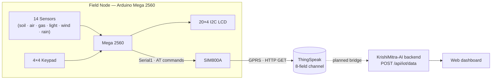

<div align="center">

# 🌾 KrishiMitra-AI — Hardware

**Arduino Mega 2560 multi-sensor field node with SIM800A GPRS uplink, 20×4 LCD, 4×4 keypad and ThingSpeak cloud logging.**


*Prototype enclosure: 20×4 LCD, gas sensor and DHT module on the top panel.*

</div>

---

## 📑 Table of Contents

- [Overview](#-overview)
- [Features](#-features)
- [Bill of Materials](#-bill-of-materials)
- [System Architecture](#-system-architecture)
- [Wiring](#-wiring)
- [Pin Map](#-pin-map)
- [Firmware Flowchart](#-firmware-flowchart)
- [Getting Started](#-getting-started)
- [Configuration](#-configuration)
- [Keypad Controls](#-keypad-controls)
- [LCD Pages](#-lcd-pages)
- [ThingSpeak Channel Setup](#-thingspeak-channel-setup)
- [SIM800A AT Command Flow](#-sim800a-at-command-flow)
- [Integration with the Software Repo](#-integration-with-the-software-repo)
- [Calibration](#-calibration)
- [Known Limitations](#-known-limitations)
- [Troubleshooting](#-troubleshooting)
- [Repository Layout](#-repository-layout)
- [Roadmap](#-roadmap)
- [Related Repositories](#-related-repositories)
- [Author](#-author)

---

## 🧭 Overview

This repository is the **hardware / firmware half** of **KrishiMitra-AI**, a farm-tech project for Indian farmers. The node sits in the field, reads soil, weather and air-quality sensors, shows live values on a 20×4 LCD, lets you browse individual readings with a 4×4 keypad, and uploads data to **ThingSpeak** every 20 seconds over **GPRS using a SIM800A** — no Wi-Fi or router needed.

> The web dashboard, backend API and farmer profiles live in the companion repo: [**KrishiMitra-AI-SOFTWARE**](https://github.com/Piyush9301/KrishiMitra-AI-SOFTWARE).

> **Note:** The hackathon pitch describes a Jetson Nano + LoRa + solar node. **This repo is the working Mega 2560 + GSM prototype.** Jetson/LoRa/solar are on the [roadmap](#-roadmap).

---

## ✨ Features

- **14 sensor inputs** on one Mega 2560: 2× soil moisture, pH, NPK index, EC, fertility, soil temperature (DS18B20), air temperature & humidity (DHT22), MQ-135 air quality, MQ-2 gas, LDR light, anemometer, wind direction, rain
- **GPRS upload to ThingSpeak** via SIM800A raw AT commands (HTTP GET, port 80) every **20 s**
- **20×4 I2C LCD (HW-61)** with **automatic I2C address detection** (falls back to `0x27`)
- **4×4 keypad** to inspect any single sensor on demand; auto-cycling pages resume after 10 s
- **Self-healing network layer**: checks the SAPBR bearer before each upload, re-opens it on `6xx` HTTP errors
- **Interrupt-driven** wind and rain counting (no missed pulses while the LCD or modem is busy)
- **Serial debug at 115200 baud** mirroring every AT command and modem reply

---

## 🧰 Bill of Materials

| # | Component | Qty | Notes |
|---|-----------|:---:|-------|
| 1 | Arduino Mega 2560 | 1 | Main controller |
| 2 | SIM800A GSM/GPRS module + antenna | 1 | Needs **3.7–4.2 V, 2 A peak** supply |
| 3 | 4 V step-down / regulated supply | 1 | Dedicated rail for SIM800A |
| 4 | 20×4 character LCD + **HW-61** (PCF8574) I2C backpack | 1 | I2C: SDA 20, SCL 21 |
| 5 | 4×4 matrix keypad | 1 | Pins 30–37 |
| 6 | Soil moisture sensor (analog) | 2 | A0, A1 |
| 7 | Soil pH sensor module (analog) | 1 | A2 |
| 8 | NPK sensor (analog output) | 1 | A3 |
| 9 | Soil EC sensor (analog) | 1 | A4 |
| 10 | Soil fertility sensor (analog) | 1 | A5 |
| 11 | DS18B20 waterproof probe | 1 | OneWire, pin 6 (+ 4.7 kΩ pull-up) |
| 12 | DHT22 | 1 | Pin 7 |
| 13 | MQ-135 air-quality module | 1 | A6 |
| 14 | MQ-2 gas module | 1 | A7 |
| 15 | LDR light module | 1 | A8 |
| 16 | Rain sensor module | 1 | D2 (interrupt) |
| 17 | Anemometer | 1 | D3 (interrupt) |
| 18 | Wind direction sensor | 1 | A9 |
| 19 | Active SIM card with GPRS data | 1 | Set your carrier APN |
| 20 | Enclosure, jumper wires, common-GND power distribution | — | |

---

## 🏗 System Architecture



---

## 🔌 Wiring

<div align="center">

</div>

**Power rules (important):**

- Arduino Mega 2560 → **5 V** (USB or regulated supply)
- SIM800A → **3.7–4.2 V, 2 A** from its own step-down. **Do not power it from the Mega's 5 V pin**; transmit bursts will brown out the board
- All sensors → 5 V as required
- **Common GND** across every module, including the SIM800A supply
- SIM800A ↔ Mega serial is a **crossover**: Mega **TX1 (D18) → SIM800A RXD**, Mega **RX1 (D19) ← SIM800A TXD**. If your breakout has no level shifter, put a resistor divider on the Mega TX1 → SIM800A RXD line

---

## 📍 Pin Map

| Function | Mega Pin | Type |
|----------|----------|------|
| Soil moisture 1 | `A0` | Analog |
| Soil moisture 2 | `A1` | Analog |
| Soil pH | `A2` | Analog |
| NPK | `A3` | Analog |
| Soil EC | `A4` | Analog |
| Soil fertility | `A5` | Analog |
| MQ-135 (air quality) | `A6` | Analog |
| MQ-2 (gas) | `A7` | Analog |
| LDR (light) | `A8` | Analog |
| Wind direction | `A9` | Analog |
| Soil temp DS18B20 | `6` | OneWire |
| DHT22 | `7` | Digital |
| Rain sensor | `2` | Interrupt (FALLING) |
| Anemometer | `3` | Interrupt (FALLING) |
| LCD (HW-61) | `20` SDA, `21` SCL | I2C |
| SIM800A | `18` TX1, `19` RX1 | Serial1 @ 9600 |
| Keypad rows | `30, 31, 32, 33` | Digital |
| Keypad columns | `34, 35, 36, 37` | Digital |
| Serial Monitor | USB | 115200 baud |

---

## 🔄 Firmware Flowchart

<div align="center">

</div>

In short: **initialize** (serial, I2C scan, LCD, keypad, sensors, interrupts, modem checks) → **loop** (read keypad, auto-cycle LCD pages every 4 s) → every **20 s** read all sensors, update the LCD, make sure the GPRS bearer is up, and push one HTTP GET to ThingSpeak.

---

## 🚀 Getting Started

### 1. Hardware

Wire everything per the [wiring diagram](#-wiring) and [pin map](#-pin-map). Insert an active SIM card, attach the antenna, and power the SIM800A from its own 2 A rail.

### 2. Arduino IDE setup

Select **Tools → Board → Arduino Mega or Mega 2560**, then install these libraries via **Library Manager**:

| Library | Purpose |
|---------|---------|
| `LiquidCrystal I2C` | 20×4 LCD via PCF8574 |
| `Keypad` (Mark Stanley) | 4×4 matrix keypad |
| `DHT sensor library` (Adafruit) + `Adafruit Unified Sensor` | DHT22 |
| `OneWire` | DS18B20 bus |
| `DallasTemperature` | DS18B20 driver |

`Wire` ships with the Arduino core.

### 3. Create a ThingSpeak channel

See [ThingSpeak Channel Setup](#-thingspeak-channel-setup) and copy the channel's **Write API Key**.

### 4. Configure and upload

Open `full_code_mega_gsm_keybord_display.ino`, edit the [CONFIG block](#-configuration), then **Upload**.

### 5. Verify

Open **Serial Monitor at 115200 baud**. You should see the I2C scan, the `AT` handshake, then every 20 seconds:

```
Existing SAPBR IP: 10.x.x.x
Final URL: http://api.thingspeak.com/update?api_key=...&field1=...
+HTTPACTION: 0,200,1
```

Status `200` means ThingSpeak accepted the update. The `AT+HTTPREAD` reply is the new entry number (`0` means the update was rejected).

---

## ⚙ Configuration

All user settings are the constants at the top of the sketch:

```cpp
const String APN                  = "internet";   // your carrier's GPRS APN
const String USER                 = "";           // APN username (usually empty)
const String PASS                 = "";           // APN password (usually empty)
const String THING_SPEAK_API_URL  = "http://api.thingspeak.com/update";
const String THING_SPEAK_API_KEY  = "YOUR_WRITE_API_KEY";
const bool   USE_SSL              = false;        // SIM800A TLS is unreliable; keep HTTP
const unsigned long SEND_INTERVAL_MS = 20000UL;   // ThingSpeak free tier: >= 15 s
```

> ⚠️ **Never commit your real Write API Key.** This is a public repo: anyone with the key can write junk into your channel. Keep the placeholder in Git, or move the key into a `secrets.h` listed in `.gitignore`. If a key was ever pushed, **regenerate it** in ThingSpeak (*Channel → API Keys*).

Other tunables:

| Constant | Default | Meaning |
|----------|---------|---------|
| `DISPLAY_PAGE_MS` | `4000` | Time per auto LCD page |
| `MANUAL_DISPLAY_MS` | `10000` | How long a keypad-selected view stays before auto mode resumes |
| `WIND_MEASURE_INTERVAL_MS` | `5000` | Anemometer sampling window during uploads |
| `RAIN_MEASURE_INTERVAL_MS` | `60000` | Rain accumulation window |
| `HTTPACTION_TIMEOUT` | `20000` | Wait for `+HTTPACTION` |
| `SAPBR_OPEN_TIMEOUT` | `30000` | Wait for GPRS bearer to open |
| `ANEMOMETER_CAL_FACTOR` | `0.66` | m/s per (pulse/s) |
| `RAIN_MM_PER_TIP` | `0.2794` | mm per rain-gauge tip |

---

## ⌨ Keypad Controls

Pressing any key switches the LCD to **manual mode** for 10 seconds, then auto-cycling resumes.

| Key | Shows on LCD |
|:---:|--------------|
| `1` | Soil moisture (primary) |
| `2` | Soil moisture (secondary) |
| `3` | Soil pH |
| `4` | Soil temperature (DS18B20) |
| `5` | NPK index |
| `6` | EC index (salinity) |
| `7` | Soil fertility |
| `8` | Air temperature + humidity (DHT22) |
| `9` | Air humidity (DHT22) |
| `0` | Light (LDR) |
| `A` | Averages: soil moisture avg, soil quality avg (NPK + EC + fertility) |
| `B` | Wind speed, wind direction, rain |
| `C` | Manual overview (page 1 of the auto cycle) |
| `D` | Return to auto mode |
| `*` `#` | Unused ("Unknown key") |

> MQ-135 and MQ-2 values appear on auto page 2 (see below).

---

## 🖥 LCD Pages

Auto mode rotates through four pages, 4 seconds each:

| Page | Content |
|:----:|---------|
| 1 | Soil moisture P/S, pH, soil temp, NPK, EC, fertility, rain |
| 2 | Air temp & humidity, MQ-135, MQ-2, light |
| 3 | Wind speed, wind direction, wind ticks, rain ticks |
| 4 | Summary: soil temp, pH, moisture P/S, air T/H, light, MQ-135 |

On boot the LCD shows the detected I2C address, then starts the cycle.

---

## ☁ ThingSpeak Channel Setup

1. Create a channel at [thingspeak.com](https://thingspeak.com) and enable **8 fields** with the names below.
2. Copy the **Write API Key** into the sketch.

The sketch sends these 8 values per update:

| ThingSpeak field | Name (suggested) | Source | Unit |
|:----------------:|------------------|--------|:----:|
| `field1` | Soil Moisture 1 | `A0` | % (raw ADC scaled 0–100) |
| `field2` | Soil Moisture 2 | `A1` | % |
| `field3` | Soil pH | `A2` | pH (linear 0–14 map) |
| `field4` | Soil Temperature | DS18B20 | °C |
| `field5` | NPK Index | `A3` | % |
| `field6` | EC Index | `A4` | % |
| `field7` | Air Temperature | DHT22 | °C |
| `field8` | Air Humidity | DHT22 | % |

> ThingSpeak channels hold 8 fields, so **fertility, MQ-135, MQ-2, light, wind and rain are shown locally on the LCD but are not uploaded**. To upload a different set, edit `buildThingSpeakURL_fromValues()` and the `String url = buildThingSpeakURL_fromValues(...)` call in `loop()`.

Free-tier ThingSpeak accepts one update per **15 seconds** per channel; the sketch uses 20.

---

## 📡 SIM800A AT Command Flow

**At boot:** `AT` → `ATE0` → `AT+CPIN?` → `AT+CSQ` → `AT+CREG?` (SIM, signal and network registration checks).

**Each upload cycle:**

```text
AT+SAPBR=2,1                         # query bearer IP
  └─ no IP? open bearer:
     AT+SAPBR=3,1,"Contype","GPRS"
     AT+SAPBR=3,1,"APN","<APN>"
     AT+SAPBR=1,1
AT+HTTPINIT
AT+HTTPPARA="CID",1
AT+HTTPSSL=0
AT+HTTPPARA="URL","<thingspeak url>"
AT+HTTPACTION=0                      # GET
  └─ wait for +HTTPACTION: 0,<status>,<len>
AT+HTTPREAD                          # on 200 / non-200
AT+HTTPTERM
```

If the status is `6xx` (module-level error), the sketch queries `AT+CSQ`, `AT+CGATT?`, `AT+SAPBR=2,1`, closes the bearer, and re-opens it.

---

## 🔗 Integration with the Software Repo

The web app ([KrishiMitra-AI-SOFTWARE](https://github.com/Piyush9301/KrishiMitra-AI-SOFTWARE)) ingests sensor data at **`POST /api/iot/data`** and shows it on its IoT and Deep Analysis dashboards. It expects this JSON body (all fields required):

```json
{
  "temp": 27.5,
  "humidity": 63,
  "light": 410,
  "gas": 120,
  "soil_temp": 24.1,
  "soil_moisture": 38,
  "soil_ph": 6.7,
  "soil_npk": 210
}
```

How the current firmware lines up with that schema:

| Backend field | Firmware source | Currently uploaded to ThingSpeak? |
|---------------|-----------------|:---:|
| `temp` | DHT22 air temperature | ✅ `field7` |
| `humidity` | DHT22 air humidity | ✅ `field8` |
| `soil_temp` | DS18B20 | ✅ `field4` |
| `soil_moisture` | Soil moisture 1 (or the average of 1 & 2) | ✅ `field1`, `field2` |
| `soil_ph` | Soil pH | ✅ `field3` |
| `soil_npk` | NPK index | ✅ `field5` |
| `light` | LDR | ❌ not in the 8 fields |
| `gas` | MQ-135 / MQ-2 | ❌ not in the 8 fields |

So **the node currently talks to ThingSpeak, not directly to the backend**. Closing the gap needs a bridge (for example a small relay that reads the ThingSpeak feed and POSTs to the backend, or an HTTP POST from the SIM800A straight to the API), plus `light` and `gas` added to the upload. See the [roadmap](#-roadmap).

---

## 🎯 Calibration

Out of the box the sketch uses simple linear mappings. **Calibrate before trusting any number agronomically.**

| Sensor | Current mapping | What to do |
|--------|-----------------|------------|
| Soil moisture 1 / 2 | `raw / 1023 × 100` | Record raw values in dry air and in water, then map between them (most analog probes read *lower* when wetter) |
| Soil pH | `raw / 1023 × 14` (placeholder) | Calibrate with pH 4.0 / 7.0 / 9.18 buffer solutions |
| NPK / EC / Fertility | `raw / 1023 × 100` (index only) | Treated as relative indices, not mg/kg or dS/m |
| MQ-135 / MQ-2 | `raw / 1023 × 100` | Allow a 24–48 h burn-in; relative index only |
| Wind speed | pulses/s × `0.66` | Calibrate against a reference anemometer |
| Wind direction | `raw / 1023 × 360` | Map to your vane's actual resistor ladder |
| Rain | tips × `0.2794` mm | Valid for a tipping-bucket gauge of that size |

---

## 🚧 Known Limitations

An honest list of what the current firmware does and doesn't do:

- **Only 8 values reach the cloud.** Fertility, MQ-135, MQ-2, LDR, wind and rain are LCD-only.
- **Calibration is placeholder-level**: pH, NPK, EC and fertility are scaled ADC counts, not engineering units.
- **Rain**: the rain module in the wiring diagram is the resistive wet/dry board (D0). The code counts pulses as bucket *tips*, so the mm figure only means something with a tipping-bucket gauge.
- **Blocking waits**: the upload cycle blocks for the 5 s wind sample plus modem I/O; keypad presses during that window are delayed.
- **Soil temperature on auto pages** reuses the last DS18B20 conversion and shows `-127` if the probe is disconnected (the keypad `4` view and the upload path report `N/A` / NaN instead).
- **Plain HTTP only**: SIM800A TLS is unreliable with modern servers, so the ThingSpeak call is unencrypted.
- **No retry queue**: a failed upload is dropped; the next one is sent 20 s later.
- **No SMS alerts** in this version of the sketch (the SIM800A is used for data only).

---

## 🛠 Troubleshooting

| Symptom | Likely cause / fix |
|---------|--------------------|
| LCD blank or garbled | Adjust the HW-61 contrast pot; check the `LCD Addr` shown on boot; confirm SDA 20 / SCL 21 |
| `[no response]` to `AT` | Swap TX/RX (must cross over), check SIM800A power (needs 2 A burst capability), confirm 9600 baud |
| `AT+CPIN?` ≠ `READY` | SIM not inserted, PIN-locked, or inactive |
| `AT+CSQ` returns `99,x` or very low | Poor signal: check antenna, move outdoors |
| `AT+SAPBR=1,1` fails / no IP | Wrong APN, no data balance, or no GPRS registration (`AT+CGATT?` should be `1`) |
| `+HTTPACTION: 0,601/603` | Network error / DNS failure: check APN and signal |
| `+HTTPACTION: 0,200` but ThingSpeak response `0` | Rate-limited (<15 s) or wrong/regenerated Write API Key |
| Modem resets mid-upload | Power rail sags under TX bursts: use a proper 2 A supply and add a 1000 µF cap near the module |
| Air temp / humidity `N/A` | DHT22 wiring or missing library; check pin 7 |
| Soil temp `N/A` or `-127` | DS18B20 not detected: check 4.7 kΩ pull-up between DATA and VCC |
| Keypad keys wrong | Confirm row pins `30–33` and column pins `34–37` match your keypad's pinout |

---

## 📁 Repository Layout

```text
KrishiMitra-AI/
├── full_code_mega_gsm_keybord_display.ino   # complete firmware
├── docs/
│   └── images/
│       ├── prototype.jpg                    # enclosure photo
│       ├── wiring-diagram.png               # full wiring diagram
│       └── flowchart.png                    # firmware flowchart
├── .gitignore
└── README.md
```

---

## 🗺 Roadmap

- [ ] Move the ThingSpeak key out of the sketch (`secrets.h`) and rotate the old key
- [ ] Real calibration routines for pH, soil moisture, EC and NPK
- [ ] Upload `light` and `gas` so the node matches the backend's `POST /api/iot/data` schema
- [ ] Build the hardware → backend bridge (ThingSpeak relay or direct POST)
- [ ] Non-blocking wind sampling (interrupt/timer based)
- [ ] Retry queue for failed uploads
- [ ] Threshold-based SMS alerts via SIM800A
- [ ] Solar power + charge controller for field deployment
- [ ] LoRa link and Jetson Nano node from the original pitch
- [ ] Waterproof enclosure and PCB instead of jumper wiring

---

## 🔗 Related Repositories

| Repo | Purpose |
|------|---------|
| [**KrishiMitra-AI-SOFTWARE**](https://github.com/Piyush9301/KrishiMitra-AI-SOFTWARE) | Web app, REST API, farmer profiles and sensor dashboards ([live demo](https://krishimitra-ai-app.vercel.app/)) |
| **KrishiMitra-AI** (this repo) | Mega 2560 sensor node firmware and wiring |

Built for **Smart India Hackathon 2025**, Problem Statement **25044**: *AI-Powered Crop Yield Prediction and Optimization* (Team ID 65681).

---

## 👤 Author

**Piyush Bopche**: [@Piyush9301](https://github.com/Piyush9301)

---

<div align="center">

🌱 *Krishi = agriculture · Mitra = friend*

</div>
